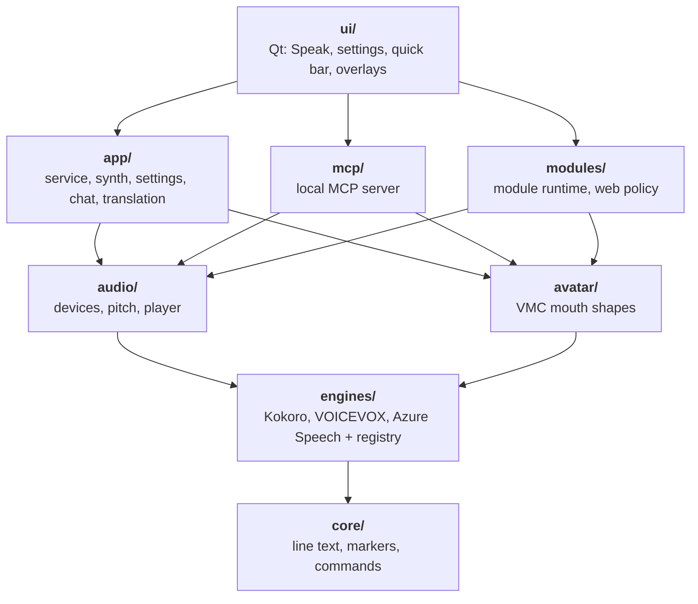

# Architecture overview

MiraSpeak is a **TTS-only** desktop app: there is no microphone path and no voice cloning. The user (or an automation) submits text; optional [translation](translation.md) turns it into the speech language; an engine synthesizes audio; the player outputs to selected devices. Optional outputs include text captions, VMC mouth blendshapes, Live Chat bridges, MCP tools, and third-party modules under Speak.

## Layer diagram

Each arrow points to the next layer down. A layer may import anything below it and nothing above it. **Qt lives only in `ui/`** (and the process entrypoint). Widgets talk to an `AppController` facade—not the service, registry, or settings I/O modules directly.

## Product constraints

| Rule | Intent |
| --- | --- |
| Engine-agnostic UI | Style, pace, voice, and marker catalogs come from each adapter’s `Capabilities`. The UI does not hard-code provider catalogs. |
| Secrets out of settings | API keys and tokens go in the OS credential store (keyring), never `settings.toml`. |
| Hotkeys without hooks | Global hotkeys use `RegisterHotKey` only—no low-level keyboard hooks. |
| Capture frozen at submit | Engine, model, voice, styles, pace, speech language, pitch, and translation choices are snapshotted on the line object while it is in flight. |
| Speech waits for a ready engine | Each engine is checked in the background; while the engine in use is not ready, speaking is off (slash commands still run, except `/render`, which needs the engine). |
| Synth ahead | Per-engine concurrency limit (how many clips may synthesize or sit ready while one plays). |
| Speech cache | Optional per-engine disk cache (pre-pitch audio); pitch applied after load. |
| Modules don’t own providers | Third-party modules speak with the user’s configured voices; they never add engines or keys. |

## Startup

1. **Profile** — `--profile NAME` picks a separate set of settings, data folders, saved keys, and single-instance lock (`MiraSpeak-NAME`). With no profile the app uses plain `MiraSpeak`. Testing a fresh setup never touches the everyday one.
2. **Single instance** — a second launch in the same profile asks the running app to show its window, then exits.
3. **Beta gate** — beta builds (a flag baked in at build time) ask the user to sign in with GitHub before anything else loads. Sign-in uses a GitHub App's device flow: the app shows a short code and the user approves it in the browser. Access means the signed-in user can read a private beta repository, so the beta list is that repository's collaborators. The token lives in the OS credential store. Access is rechecked at each launch, and if GitHub can't be reached the app keeps working for 7 days after the last successful check. Regular builds skip this step.
4. **Settings and controller** — settings load, then the controller, tray, and window start.

Builds are one-folder PyInstaller bundles made on each target OS.

## Style and pace

**Style** (delivery) and **Pace** (speed) are separate UI chips fed by the active adapter. Engines that support multi-style (e.g. Azure Dragon HD / Omni) expose a checklist Style picker; others stay single-select. Unsupported styles degrade to the engine default. Bracket markers in text are not a second style channel for chip state—inline markers are scrubbed or kept according to the adapter’s marker catalog plus MiraSpeak-wide `[date]` / `[time]` (expanded at synth/play from the local clock; `[time:full]`, `[time:24h]`, `[time:tod]`, `[time:h|m|s]`).

## Navigation surface (settings)

Typical top-level groups:

1. **Speak** — main thread, then one row per enabled module page  
2. **Voice Engines** — Kokoro, VOICEVOX, Azure Speech (cache / usage where relevant)  
3. **Translation** — Translation, Azure Translator, Argos  
4. **Voice** — Presets, Commands, Marker Aliases  
5. **Output** — Audio Devices, Text Output, Avatar (VMC)  
6. **Integrations** — Live Chat, MCP, Modules (enable, permissions, Browser Source)  
7. **Interface** — Quick Bar, Appearance (themes, Font Sets)  
