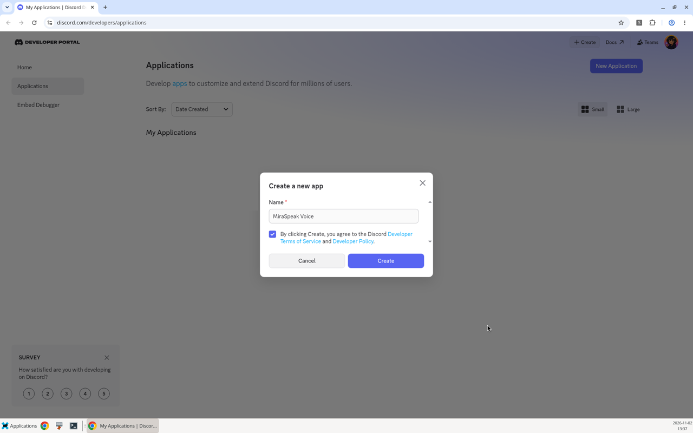
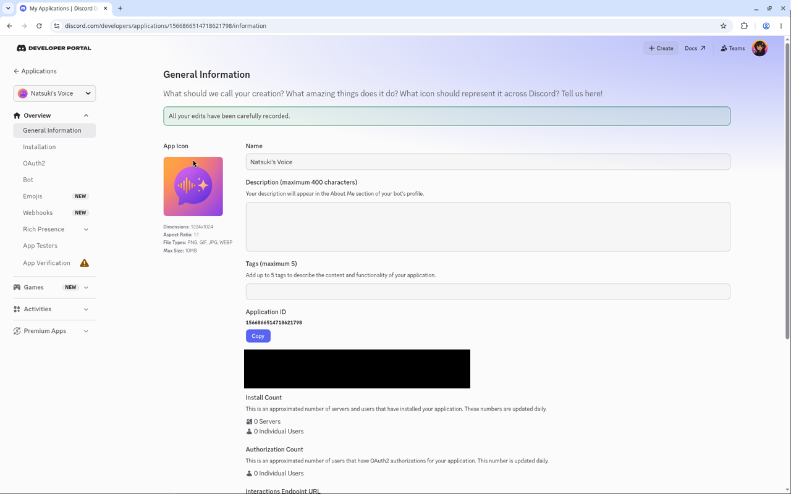
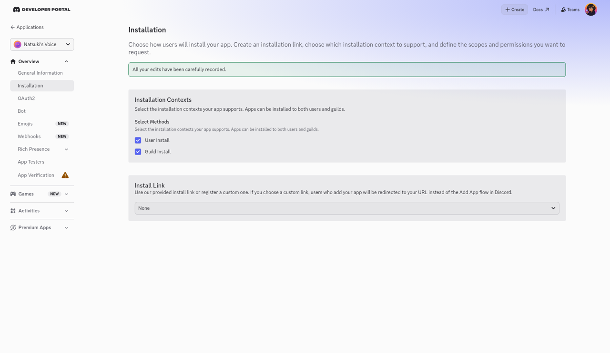
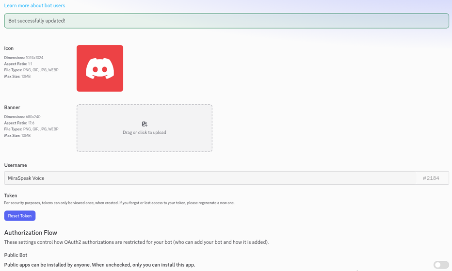
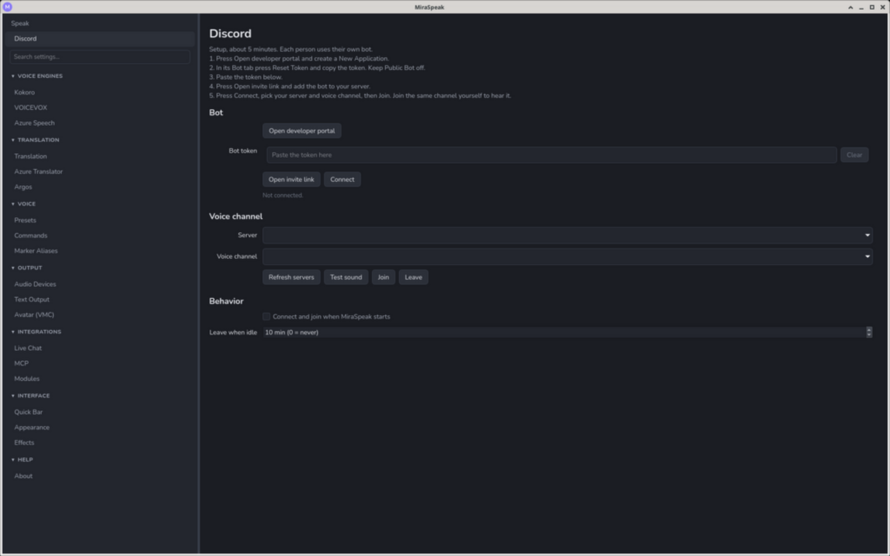
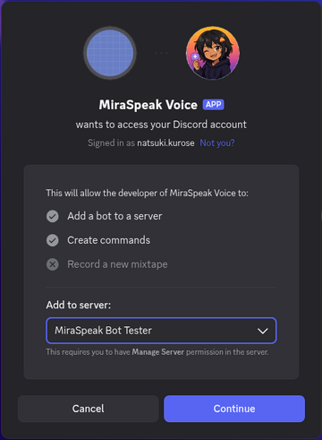
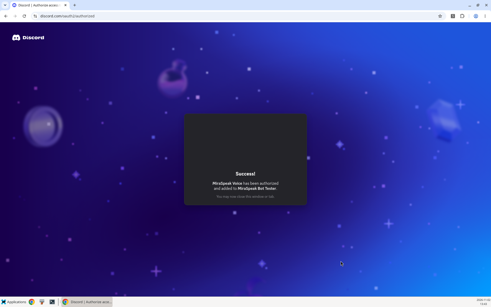
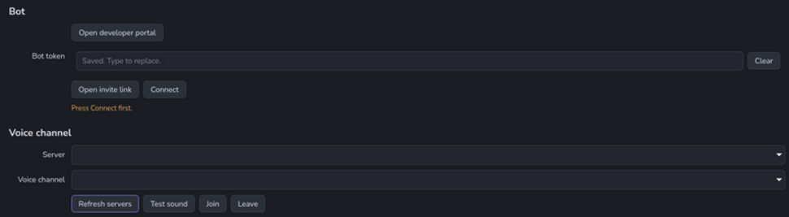
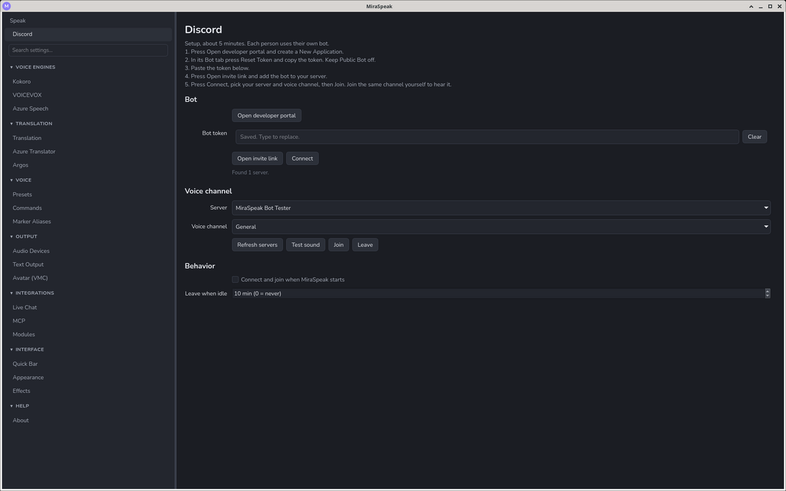
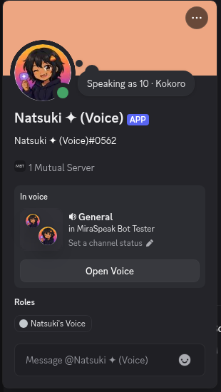

# Discord voice channel setup

MiraSpeak's **Discord** module lets a bot join your voice channel and play everything MiraSpeak speaks, so friends hear your TTS voice in calls without a virtual audio cable. This guide creates your own Discord bot and then connects it in MiraSpeak.

- It's **your own bot**. MiraSpeak doesn't ship a shared bot, so the name and avatar are yours to choose, and you can change them later right from MiraSpeak (see [Bot profile](#bot-profile)).
- It's free. Discord doesn't charge for bots or voice, and the bot runs inside MiraSpeak on your computer.
- MiraSpeak keeps the bot token in your OS credential store (keyring), never in `settings.toml`. If the credential store is unavailable, the token is kept for the current session only (see [Troubleshooting](#troubleshooting)).

> **Security note:** the bot token lets anyone control your bot. Never commit it, paste it in chat, or show it on stream. If it leaks, reset it (see [Troubleshooting](#troubleshooting)).

## 1. Create the bot in the Discord developer portal

Open the [Discord developer portal](https://discord.com/developers/applications). You can also click **Open developer portal** on MiraSpeak's Discord page.

1. Click **New Application** and give it a name, for example the name of your character.

   

   On **General Information** you can set the app icon. The Application ID is fine to share; keep the Public Key to yourself (it isn't needed here).

   

2. **Installation** tab: set **Install Link** to **None** and save. Do this first: Discord won't let you turn **Public Bot** off while an install link is set.

   

3. **Bot** tab: turn **Public Bot** off, so only you can add it to servers, and save.

   

4. Still on the **Bot** tab, click **Reset Token** and copy the token. It's shown **once**.
   - You need the **Bot token**. The Public Key, Client ID and Client Secret won't work.

## 2. Enable the module in MiraSpeak

**Settings → Integrations → Modules**

1. Enable **Discord**.
2. Approve the permissions it asks for.

## 3. Connect the bot

Open the **Discord** page. It's at the top of the sidebar, directly under **Speak**.

**Bot** section

1. Paste the token into **Bot token**. It stays private on your computer.
2. Click **Open invite link**, pick your server and click **Authorize**. You need the **Manage Server** permission on that server.

   

   Discord confirms when the bot has been added:

   

3. Click **Connect**. The status should read `Connected as <bot name>`. Until you connect, the voice channel controls show "Press Connect first."

   

**Voice channel** section

4. Click **Refresh servers**, then pick your **Server** and **Voice channel**.
5. Join that voice channel yourself in Discord, so you can hear the bot.
6. Click **Join**, then **Test sound**. The status shows how much audio was sent and its peak level.

From now on, every line MiraSpeak speaks also plays in the voice channel. Click **Leave** to disconnect the bot from the channel.

## Bot profile

The **Bot profile** section on the Discord page changes how the bot looks in Discord without opening the developer portal. Connect first; the buttons stay disabled until the bot is connected.

1. **Avatar**: click **Browse**, pick a PNG, JPG, GIF or WEBP image (up to 8 MB), then click **Update avatar**.
2. **Name**: type the new name, then click **Update name**. Discord only lets a bot rename a couple of times an hour.
3. **Show "Speaking as <voice>" as the bot's activity** (on by default): the bot's status shows the voice of the line that's playing. It appears once the first line plays and changes when the voice changes. Turn it off to clear the status.

The activity follows every line MiraSpeak speaks, which is why the module asks for permission to see spoken lines.

## Behavior settings

| Setting | What it does |
| --- | --- |
| Connect and join when MiraSpeak starts | Reconnects and rejoins the last channel automatically (on by default) |
| Leave when idle | Leaves the channel after this many quiet minutes (default 10, up to 240). `0` means never |

## Troubleshooting

The status line on the Discord page tells you what's wrong. The common messages are below.

| Status message | Fix |
| --- | --- |
| "Connected as …, but the bot is not in any server" | The invite didn't finish. Click **Open invite link** again, then **Refresh servers** |
| "That does not look like a bot token" | You copied the Public Key, Client ID or Client Secret. Copy the token from the **Bot** tab |
| "Discord rejected the token" | **Reset Token** in the portal and paste the new token. Never share it |
| "The bot can't see #…" / "lacks Connect" / "lacks Speak" | Give the bot **View Channel**, **Connect** and **Speak** in that channel's permissions |
| "The bot is server-muted in #…" | In Discord, right-click the bot and untick **Server Mute** |
| "The bot is suppressed in Stage #…" | In a Stage channel, a moderator must invite the bot to speak |
| "The bot muted itself in #…" | Click **Leave**, then **Join** again |
| "Removed from #…" | Someone disconnected the bot. Click **Join** to return |
| "That channel is gone" | Click **Connect** to refresh the lists |
| Test sound plays but nobody hears it | Make sure you or other people are in the voice channel before the bot joins, then click **Leave** and **Join** |
| "Discord voice needs libopus" (Linux) | Install libopus, for example `sudo apt install libopus0` |
| "Kept for this session only; the system credential store is unavailable" | MiraSpeak couldn't reach your OS credential store (keyring), so the token is kept for this session only and you'll need to paste it again next time. Fix or enable the keyring to save it. Advanced users can set the `MIRASPEAK_DISCORD_TOKEN` environment variable instead |
| The bot joins the voice channel and immediately leaves | Your network or firewall is probably blocking Discord voice. Voice needs outbound ports beyond 443 (for example 2083/2096 for the voice websocket) and UDP. Try another network, or allow those ports and UDP in your firewall |
| "Discord says try again in … minutes" / "Bots can only rename a couple of times an hour" | Discord rate-limits profile changes. Wait the time shown, then try again |
| No "Speaking as" status on the bot | Check the toggle is on, play a line, and make sure you approved the module's permissions. If you enabled the module before updating, disable and re-enable it to approve the new permission |
| "Discord support is not installed in this copy of MiraSpeak" | Your build doesn't include Discord support. Update to the latest MiraSpeak build |
