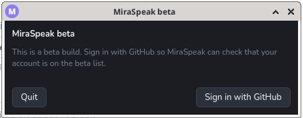
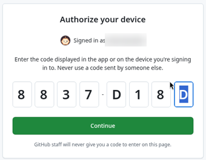
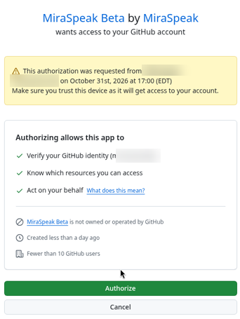
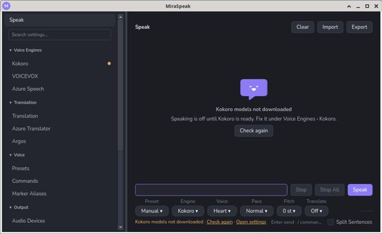
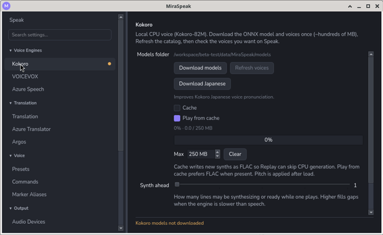
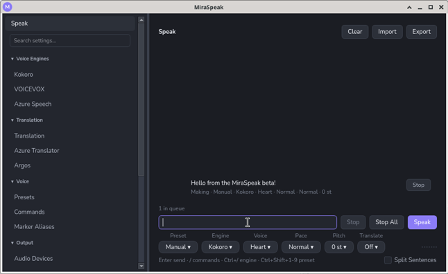
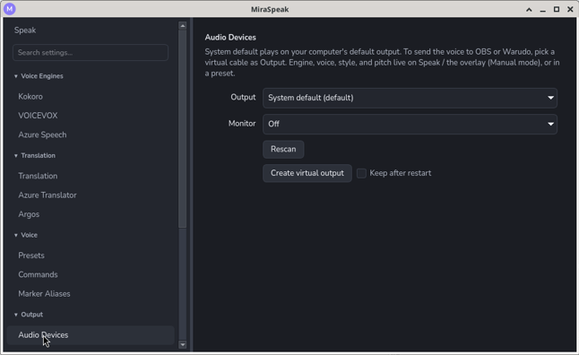

# Quick start

Install MiraSpeak, get a free local voice, and hear your first line. It takes about ten minutes, most of it the one-time voice download.

- You don't need an account, an API key, or a virtual audio cable to get started.
- Streaming setup (OBS), avatar mouth movement (VMC), and cloud voices are optional. See [Next steps](#7-next-steps).

## 1. What you need

- Windows 10 or 11 (x64), or a 64-bit Linux desktop with PulseAudio or PipeWire.
- About 350 MB of free disk space for the Kokoro voice models (a download of about 300 MB).

## 2. Install and start MiraSpeak

<!-- TODO: replace with the release URL once the first public build is published. -->

1. Download `MiraSpeak-<version>-windows-x64.zip` from <download link>.
2. Extract the zip anywhere you like, for example `C:\Apps\MiraSpeak`. Keep the whole `MiraSpeak` folder together.
3. Run `MiraSpeak.exe`. The build isn't code-signed yet, so Windows SmartScreen may warn you: click **More info**, then **Run anyway**.

MiraSpeak starts in the system tray (check the **^** overflow next to the clock if you don't see the icon). Click the icon to open the window. Closing the window keeps MiraSpeak running in the tray. To exit, right-click the icon and choose **Quit**.

**On Linux:** download `MiraSpeak-<version>-linux-x86_64` from the same release, extract it, and run `MiraSpeak` from the folder. Your desktop needs a system tray (most do; on GNOME, install the AppIndicator extension). Global hotkeys (the quick bar shortcut and **Ctrl+Shift+1–9**) are Windows-only for now, so on Linux use the window or the tray instead.

> **Beta testers:** beta builds ask you to sign in with GitHub before the app starts. Regular builds don't.
>
> 1. Accept your invite at [github.com/MiraSpeak/MiraSpeak-beta/invitations](https://github.com/MiraSpeak/MiraSpeak-beta/invitations) first.
> 2. Download `MiraSpeak-<version>-beta-windows-x64.zip` (or the `linux-x86_64` build) from the [beta releases](https://github.com/MiraSpeak/MiraSpeak-beta/releases/latest) and extract it as above.
> 3. On first launch, click **Sign in with GitHub**. GitHub opens in your browser with the code already on your clipboard. Paste it there and approve MiraSpeak.
>
>    
>
>    
>
>    
>
> MiraSpeak checks your beta access each time it starts. If GitHub can't be reached, it keeps working for up to 7 days after the last successful check.

## 3. Get a voice

MiraSpeak's built-in engine, **Kokoro**, is free and runs entirely on your PC.

Until then, Speak shows that Kokoro isn't downloaded yet:

1. In the MiraSpeak window, open **Voice Engines → Kokoro**.
2. Click **Download models**. This is a one-time download.

   

The default voice (Heart) works as soon as the download finishes. To pick from more voices later, click **Refresh voices** and check the ones you want to see on Speak. **Download Japanese** on the same page improves Kokoro Japanese voice pronunciation. Other languages do not need it.

## 4. Speak your first line

1. Open **Speak**.
2. Type a line and press **Enter**.

   

You hear it on your computer's default speakers or headphones. To use a different device, open **Output → Audio Devices** and change **Output**.

To change the voice, pick **Manual** on the **Preset** chip, then use the chips under the line box: **Engine**, **Voice**, **Style**, **Pace**, and **Pitch**. Which chips appear depends on the engine and voice.

## 5. Speak while gaming

Press **Ctrl+Shift+Space** to open the quick bar over your game.

| Key | What it does |
| --- | --- |
| **Enter** | Speak and close the bar |
| **Shift+Enter** | Speak and keep the bar open |
| **Esc** | Close the bar |
| **/** | Search commands (switch voice, preset, theme, and more) |
| **Ctrl+/** | Pick an engine (in Manual) or a preset |

Focus goes back to your game when the bar closes. You can change the shortcut under **Interface → Quick Bar**.

## 6. Save voices as presets

Open **Voice → Presets** and fill a slot with an engine, voice, style, pace, and pitch. **Play** previews it.

Press **Ctrl+Shift+1** through **Ctrl+Shift+9** to switch to slots 1–9 from anywhere, even in game. **Add preset** adds more slots, which you pick from the **Preset** chip or with `/preset`.

## 7. Next steps

- **Send the voice to OBS:** open **Output → Audio Devices → Set up VB-Cable**. After the installer finishes (reboot if it asks), click **Rescan**. Output switches to `CABLE Input`. In OBS, use `CABLE Output` as the microphone. Set **Monitor** to your headphones to keep hearing yourself (Monitor is a second copy of each line, played alongside Output).
- **Send the voice to OBS on Linux:** open **Output → Audio Devices** and click **Create virtual output**. It creates a `MiraSpeak` sink and switches Output to it. In OBS, add an **Audio Input Capture** and pick **Monitor of MiraSpeak**.
- **On-stream captions:** turn on **Output → Text Output → Caption file** and point an OBS Text source at the file.
- **Azure voices and translation:** see [Azure Speech + Translator](azure-speech-translator.md).
- **Japanese character voices:** install and run [VOICEVOX](https://voicevox.hiroshiba.jp/), then open **Voice Engines → VOICEVOX** and click **Refresh voices**.
- **Twitch chat:** **Integrations → Live Chat** can speak your own chat messages, or post what you speak to your channel.
- **Avatar mouth movement:** **Output → Avatar (VMC)** sends mouth shapes to a VMC receiver, such as Warudo, while a line plays.
- **AI agents:** **Integrations → MCP** lets an agent such as Cursor drive MiraSpeak. To reach it from a cloud agent, see [Remote MCP via Cloudflare](remote-mcp-cloudflare.md).
- **Themes:** **Interface → Appearance** or `/theme` switches between the built-in themes, most of them in Light, Dark, and Midtones. To make your own, click **Duplicate** and edit the copy.
- **Modules:** **Integrations → Modules** installs add-ons such as a timer or lyrics reader. Only install modules from people you trust.

## Tips for typing lines

- `[date]` and `[time]` are read out as the current date and time when the line plays.
- Stray `[brackets]` are skipped, not spoken. Type `[[` for a literal `[`.
- Check **Split Sentences** under the line box to speak each sentence as its own line.
- Start a line with `//` to speak a leading slash instead of running a command.

## Troubleshooting

| Symptom | Fix |
| --- | --- |
| You hear nothing | Check **Output → Audio Devices → Output**. Monitor is only an extra copy of Output, so it never plays on its own. Click **Rescan** after plugging in a device or changing the Windows default. |
| A line fails with "Output device '…' not found" | A device you picked is unplugged or gone. Pick another, or **System default**. |
| A line fails with "No default output device" | Windows has no default playback device. Set one in Windows sound settings, then **Rescan**, or pick a device under **Output**. |
| The Speak button is greyed out | The engine isn't ready yet: download the Kokoro models (step 3), or start VOICEVOX if you're using it. |
| The quick bar shortcut does nothing | Another app already uses it. Pick a different one under **Interface → Quick Bar → Hotkey**. |
| The window doesn't appear when you start MiraSpeak | It's already running in the tray. Click the tray icon. |
| Beta: "Not on the beta list" | Accept the invite at [github.com/MiraSpeak/MiraSpeak-beta/invitations](https://github.com/MiraSpeak/MiraSpeak-beta/invitations), then click **Check again**. Signed in with the wrong account? Sign out of GitHub in your browser, then click **Use another account**. |
| Beta: "Can't reach GitHub" | It's been more than 7 days since MiraSpeak last confirmed your access. Reconnect, then click **Try again**. |
